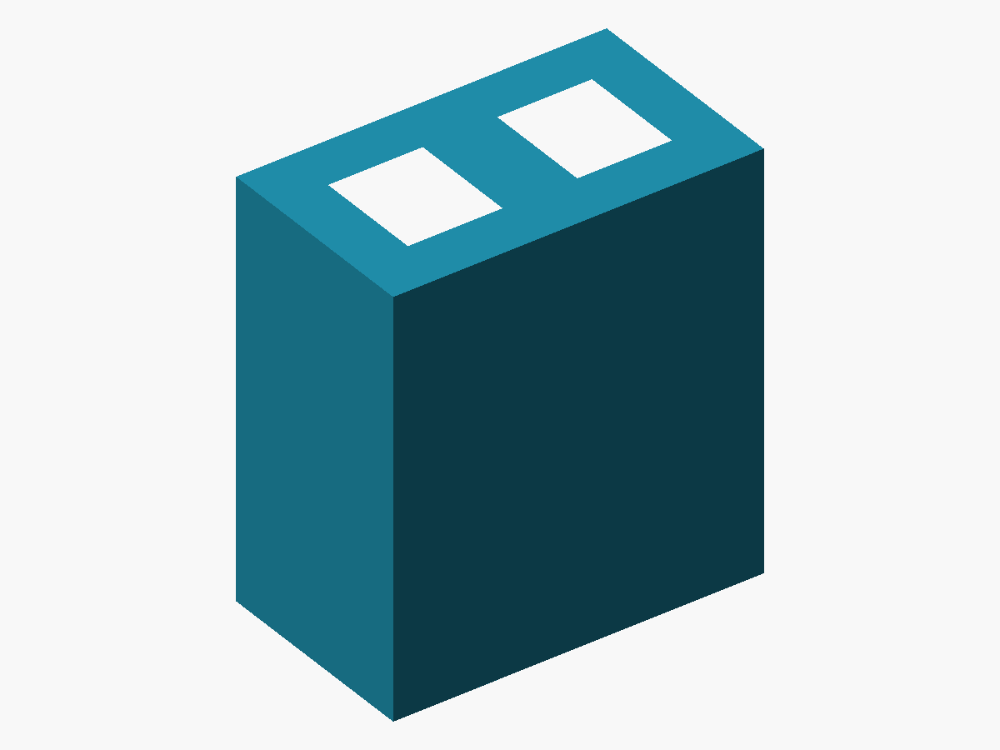

# Paired pin sleeve V2

A single printed sleeve connects two straight LED tails to two individual male jumper pins entering from the opposite end. Each electrically separate passage is enclosed on four sides and provides a common direct-contact cavity for one LED lead and its jumper. There is no extra terminal, assembly piece or internal support piece.

The user reports that this enclosed V2 works with a yellow LED and that the LED flashes: a **basic functional demonstration**, not formal qualification. Tested lead dimensions, duration, sample count, equipment, current, retention and resistance measurements were not supplied. The sizes below are nominal CAD assumptions.

## Print and use

1. Choose [sleeve_pair_v2.stl](stl/sleeve_pair_v2.stl), the sole printable part, in mm at 100% scale.
2. Slice upright as supplied: both bores vertical, larger LED mouths up, smaller jumper mouths on the bed. PETG, a 0.4 mm nozzle and 0.2 mm layers are starting guidance. Use supports off and raft off; keep both bores free of internal brim or support. Inspect first-layer spread and passage clearance.
3. Print and inspect the open passages. No internal piece is intended for removal.
4. With power off, support the LED and slide the sleeve over its short, straight tails from the larger mouths. Introduce each individual jumper from the opposite, smaller mouth, parallel above its corresponding LED lead in the contact cavity. Keep collars outside. Seat gently with fingers clear of the closing gap; stop if tips butt or bind, withdraw and realign instead of forcing or bending the LED. Support the wires externally.
5. Check each lead-to-own-jumper connection and isolation between channels. Confirm LED polarity and operation in a current-limited, low-current circuit with a series resistor. Recheck after gentle wire movement.

The body guides the pins but does not reliably select opposing halves or force metal faces together. The nominal 0.12 mm stack clearance is **not active preload**. Two identical 0.64 mm jumpers are not supported by default.

## Nominal geometry

| Feature | Size (mm) |
| --- | --- |
| Upright footprint × height | 5.56 × 3.26 × 6.20 |
| Passage pitch | 2.54 |
| LED mouth, width × height | 1.42 × 1.66 |
| Jumper mouth, width × height | 1.42 × 1.26 |
| Shared bore, width × height | 1.02 × 1.26 |
| Narrow jumper guide, width × height | 1.02 × 0.86 |
| Minimum exterior wall / divider | 0.80 / 1.12 |

Assembly axial X runs from the LED mouth at 0 to the jumper face at 6.20; LED leads rest on the cavity floor. The supplied print orientation maps the jumper face to print Z=0. Nominal assumptions are 0.50 mm square LED leads with 4–5 mm short straight tails, and 0.64 mm square male jumpers with 6 mm exposed metal. A 0.60 mm assumed male tip taper gives 3.2–4.2 mm full-section overlap when seated without setbacks. Setback, collar standoff and actual tip shapes reduce overlap. Independent collars may need outward positioning; a rigid header is not the assumed input.

## Files and supplied print profile

- [Editable OpenSCAD](cad/paired-pin-sleeve-v2.scad): default `view="print"` is the body. Assembly/cutaway views and colored pin/collar proxies are illustrative, not printable parts. Release edits affect comments only; executable tokens and parameters are unchanged.
- [Exact STL](stl/sleeve_pair_v2.stl): retained unchanged, including its original filename.
- [Original supplied G-code](gcode/paired_led_jumper_sleeve_v2-Ender-3%20V3%20KE_0.4_CR-PETG_2m.gcode): original attachment filename without its transport prefix; bytes unchanged. See [profile findings](../../docs/supplied-gcode.md).

The supplied G-code records two walls / 0.8 mm, 15% grid infill, supports disabled, zero support and skirt/brim time, 31 layers and an estimated 124.431 seconds. This differs from the earlier CAD note proposing 100% small-region fill. Its 230 °C nozzle and 80 °C bed are supplied-profile values, not universal PETG temperature recommendations. Re-slice the exact STL for other printers.

[License and contacts](../../docs/licensing.md) · [CERN-OHL-S-2.0](../../LICENSE)
