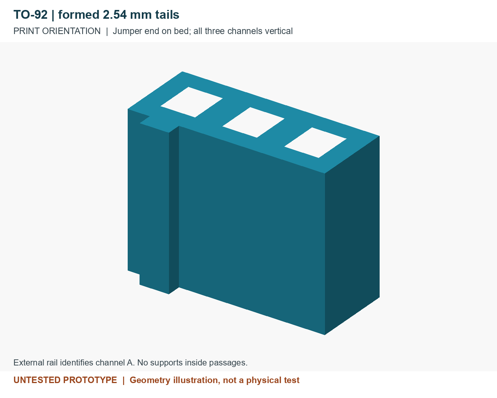
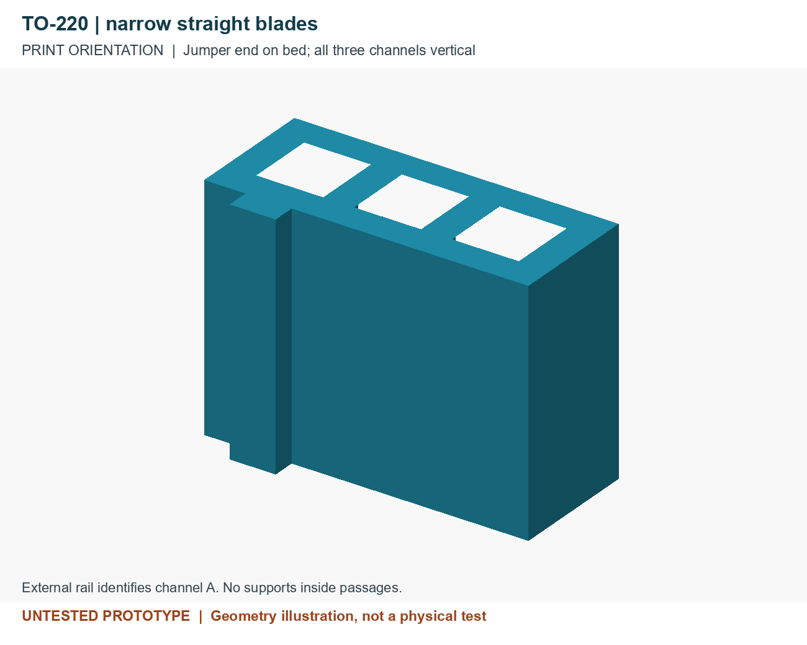
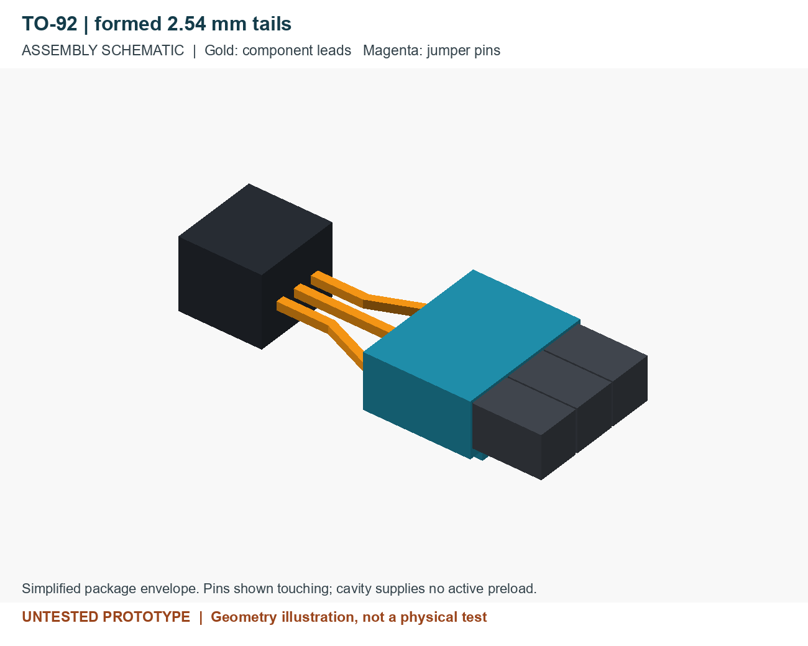
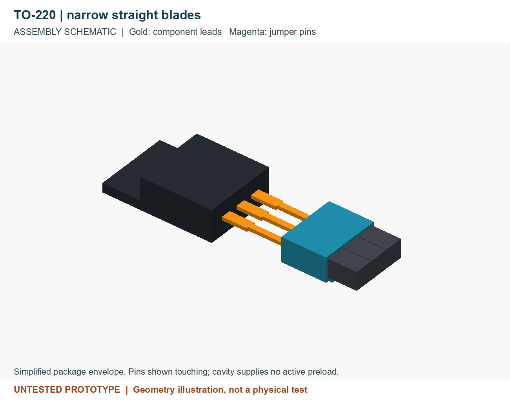
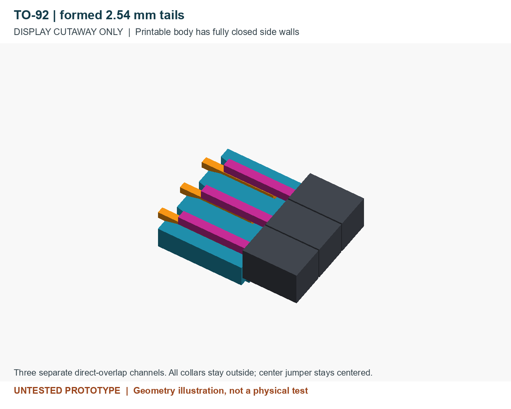
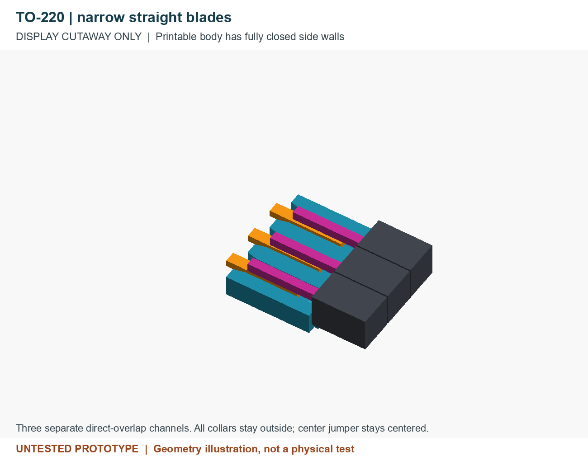

# Three-channel sleeves

**Untested prototype: neither model has been printed or electrically tested.** These are simple one-piece adaptations of the enclosed paired V2: each component lead overlaps one opposing male jumper in its own straight passage. The yellow-LED demonstration belongs **only** to the [original pair](../paired-pin-sleeve/README.md).

No exact user component is confirmed. Select by measured leads and usable straight length, not the package name alone. Package style does not determine electrical pinout.

## Select a prototype

| Model | Intended engagement | Printable mesh | Editable source |
| --- | --- | --- | --- |
| TO-92, **formed 2.54 mm tails** | Three separately preformed parallel tails; **not native 1.27 mm pitch** | [TO-92 STL](stl/to92-formed-254.stl) | [OpenSCAD](cad/to92-formed-254.scad) |
| TO-220, **narrow straight blades** | Distal rectangular blades near 2.54 mm pitch; wider shoulders stay outside | [TO-220 STL](stl/to220-narrow-254.stl) | [OpenSCAD](cad/to220-narrow-254.scad) |

Each STL contains one closed-sided body with three through passages. There are no lids, side slots, spring tongues or removable internal pieces. Both primary sources use the [common helper](cad/three-channel-common.scad); keep all three SCAD files together. Default `view="print"` exports only the body. `assembly` and `cutaway` are illustrations with nonprinting proxies.

## Geometry and limits

All dimensions are mm. Width is across the row; thickness is perpendicular to the row. Keep the rectangular lead's broad face parallel to the jumper contact face.

| Feature | TO-92 formed | TO-220 narrow |
| --- | ---: | ---: |
| Print bounds, including reference rail | 8.10 x 3.86 x 6.20 | 8.42 x 4.00 x 6.20 |
| Adjacent channel pitch | 2.54 | 2.54 |
| Shared bore, width x stack height | 1.02 x 1.26 | 1.34 x 1.40 |
| Component mouth, width x height | 1.42 x 1.66 | 1.74 x 1.80 |
| Jumper mouth, width x height | 1.42 x 1.40 | 1.74 x 1.50 |
| Narrow jumper guide, width x height | 1.02 x 1.00 | 1.34 x 1.10 |
| Minimum exterior wall / divider | 0.80 / 1.12 | 0.80 / 0.80 |
| Nominal component lead, width x thickness | 0.50 x 0.50 | 0.80 x 0.49 |
| Analyzed lead width / thickness envelope | 0.36-0.56 / 0.30-0.52 | 0.64-0.96 / 0.36-0.61 |
| Free stack clearance with a 0.64 jumper | 0.10-0.32 | 0.15-0.40 |

These are **ideal CAD clearance envelopes**, not qualified fits or printer tolerances. Narrower or thinner leads have more freedom and may make unreliable contact. Wider clearance does not improve contact pressure. Neither cavity forces the metal faces together or reliably selects the correct halves. There is no active preload, locking feature or rated retention.

The broad external rail (1.20 wide, 0.60 high, full body length) identifies **channel A**; B is center, C is the other outer channel. It does not indicate polarity or electrical function. It does not distinguish the two axial ends; the larger component mouths are at the top in the supplied print orientation.

## Prepare the component

**TO-92:** unformed leads can be 1.27 mm apart. A 1.42 mm mouth would overlap the adjacent mouth at that pitch, and adjacent 2.54 mm jumper collars would collide. This design therefore requires external lead forming to **2.54 mm adjacent / 5.08 mm outer span** before insertion. It does not bend or fan out leads internally.

Support each lead between the package and the bend; never lever against the package or use the sleeve to force the spread. Follow the specific component maker's forming restrictions. An illustrative layout leaves the first 3 mm below the body straight, spreads the outer leads over the next 3 mm, then leaves **at least 5.5 mm of straight parallel distal tail**. Use gentle bends; the schematic's sharp corners are not a bend-radius prescription. Form and inspect without the connector:

- With the center lead aligned, target centers at -2.54, 0 and +2.54 mm. The analyzed ideal envelope allows each outer center within 0.13 mm of its target throughout engagement. At maximum 0.56 mm lead width this leaves 0.10 mm nominal CAD side clearance; printing error can consume it.
- Keep all three tails coplanar, parallel and untwisted. Precise equal-length trimming is not required.
- Check each actual tail independently: insert only 4.0-5.0 mm and leave at least 0.5 mm between its last bend and the component mouth. The illustrative 3 + 3 + 5.5 mm layout gives a body-to-mouth stand-off of about 6.5-7.5 mm.
- Factory formed leads still need measurement: CASE 135AR specifies 2.40-2.80 mm pitch, not a guaranteed exact 2.54 mm. Long tails can remain outside; do not seat the sleeve against the package.

**TO-220:** use only an unbent distal shank in the stated width/thickness envelope. After aligning the center lead, each outer lead center must lie within 0.13 mm of its nominal +/-2.54 mm position through engagement. At maximum blade width this leaves only 0.06 mm lateral CAD clearance on the limiting side; printing error can consume it. Check actual straightness, plating, burrs and the printed bore before assembly.

CASE 221A has a much wider shoulder (`b` 1.15-1.52 mm) than the distal blade (`b1` 0.64-0.96 mm). The conservative straight-shank estimate is `L min - L1 max = 12.70 - 4.10 = 8.60 mm`. With 4-5 mm distal insertion, the shoulder remains at least 3.60 mm outside the mouth and the package body at least 7.70 mm away for that minimum-length example. Do not insert the shoulder, body irregularity zone, bent/kinked leads or other TO-220 variants. Verify the actual part has at least 8.60 mm of suitable narrowed straight shank before using this envelope.

## Print and assemble

1. Slice the selected STL in mm at 100%, upright as supplied: jumper mouths on the bed, larger component mouths upward. PETG, 0.4 mm nozzle and 0.2 mm layers are starting assumptions. Use at least two perimeters with small gaps filled; inspect the 0.80 mm TO-220 dividers. Supports and raft off; no support or brim inside the bores. Use printer/material-specific temperatures. **No new G-code is supplied; do not reuse the pair's G-code.**
2. Inspect all three passages for first-layer spread, strings and obstruction. The intended print is one piece; no internal piece should be extracted. Check with measured unpowered proxies. Stop on binding; do not force or use a transistor as a reamer.
3. With power off, hold the component leads against the common cavity floor and engage 4-5 mm from the larger mouths. The guide ramp starts at axial X=5.20, beyond the component tips. Keep bends and shoulders outside.
4. Use **three independent 0.64 mm square male jumpers**, each with **5.5-6.0 mm usable exposed metal**, including a tip taper no longer than 0.60 mm. Measure the metal that can actually enter; a recessed collar opening reduces usable length. Keep collars at or up to 0.30 mm away from the jumper face.
5. Insert jumpers straight and parallel above the component leads. Keep the center jumper centered; offset each outer jumper outward by 0.10 mm. With square collar envelopes no larger than **2.54 x 2.54 mm**, this produces 0.10 mm clearance on both sides of the center collar. Collars remain entirely outside. Larger collars, projecting latch features, rotated collars and rigid headers are outside the analyzed arrangement. Stop if tips butt; withdraw and realign.
6. Support wires externally. Check continuity lead-to-own-jumper and isolation between every channel pair, then recheck during gentle wire movement. Physical insertion force, pull-out force, contact resistance and repeated-use behavior remain unmeasured.

At these insertion limits the full rectangular metal sections overlap axially by **2.4-4.2 mm**, excluding the jumper taper. The nominal illustrated pose gives 3.7 mm. Across the row, the TO-92 envelope retains at least 0.27 mm of metal-face overlap even with outer lead displacement of +/-0.13 mm and the outer jumper's 0.10 mm outward offset. Jumper noses remain 0.20-1.00 mm inside the component face; component tips remain 1.20-2.20 mm inside the jumper face. Those geometric margins do not establish reliable contact.

Use only for low-current bench prototypes. Fitting a power-transistor package does not make this a heatsink or a power connector. No electrical ratings are assigned.

## Drawing basis and verification

- [onsemi 2N3904, Rev. 3](https://www.onsemi.com/download/data-sheet/pdf/2n3904-d.pdf), PDF pages 7-8 (indices 6-7): CASE 135AN issue O shows 1.27 adjacent / 2.54 outer pitch and 0.36-0.56 wide, 0.30-0.52 thick leads. CASE 135AR issue O is a formed example with 2.40-2.80 pitch, a 2.54-3.44 mm forming region below the body and 10.50-13.00 mm distal straight length. These are examples, not universal TO-92 dimensions or forming instructions.
- [onsemi TIP120 family, Rev. 10](https://www.onsemi.com/download/data-sheet/pdf/tip120-d.pdf), PDF page 8 (index 7): CASE 221A issue AL, 05 Feb 2025. Labels `e` = 2.42/2.54/2.66 min/nom/max, `e1` = 4.83-5.33, `b1` = 0.64-0.96, `b` = 1.15-1.52, `c` = 0.36-0.61, `L` = 12.70-14.27, `L1` = 2.80-4.10; `Z` allows local irregularities near the body. The narrowing and stand-off limit the selected geometry.

The drawings were inspected visually. No manufacturer PDF or drawing image is redistributed here. No TMP36 compatibility is asserted.

OpenSCAD exports were checked as one connected watertight positive-volume solid each, with the jumper face at print Z=0 within mesh precision. Forty-two transverse sections per model include all 31 layer midplanes and both sides of transitions; each has three separate holes with a continuous straight core. Nominal minimum walls are as tabulated. Ideal rigid proxy sweeps covered 64 combinations per model of lead extremes, lateral offsets, insertion, jumper length and collar stand-off; nominal shoulders, packages and all three collars clear the body. These checks assume aligned contacting faces and do not predict force or electrical reliability.

The largest inward wall step is 0.10 mm per 0.20 mm layer, leaving 75% nominal overlap for a 0.40 mm extrusion. There is no roof bridging the passages. This supports a support-free starting orientation; it is **mesh/layer analysis only**, without a slicer preview or physical print. Verify extrusion placement and first-layer clearance in your slicer.

Actual transverse mesh sections and illustrative longitudinal contact sections: [TO-92](previews/to92-formed-254-sections.png) / [TO-220](previews/to220-narrow-254-sections.png). Remaining work is measured part selection, print clearance, lead-forming inspection, insertion/retention measurements, continuity/isolation and contact stability under movement and repeated insertion.

[License and contacts](../../docs/licensing.md) | [CERN-OHL-S-2.0](../../LICENSE)
